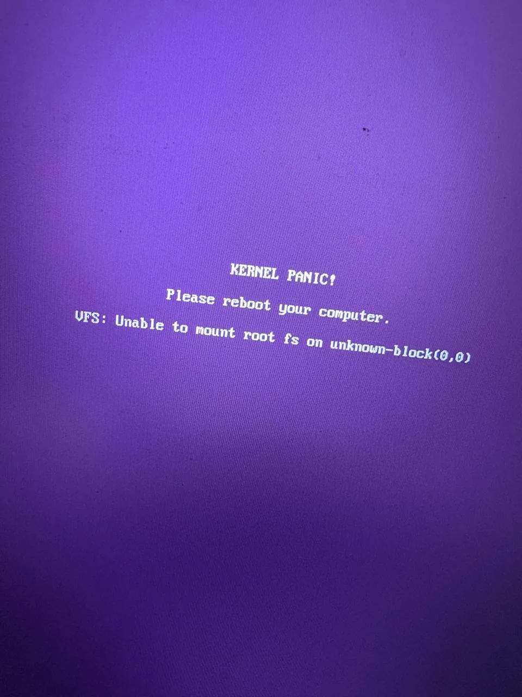
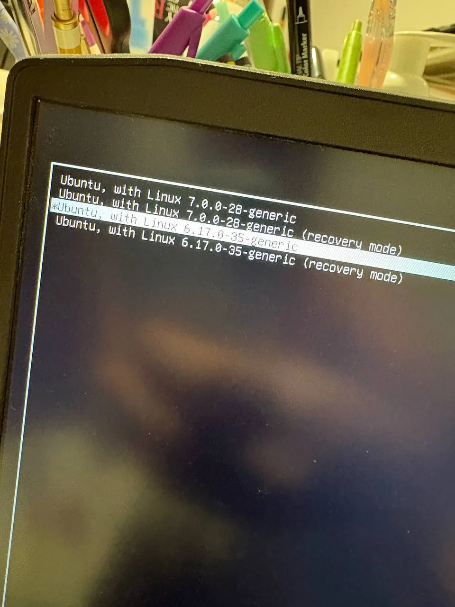

A few days ago, after an update, my ubuntu installation decided that booting was optional

Instead of reaching the desktop, the new `7.0.0-28-generic` kernel stopped with this message:

```text
KERNEL PANIC!
Please reboot your computer.
VFS: Unable to mount root fs on unknown-block(0,0)
```



Well, not exactly the nicest screen to find after an update.

The message means that the kernel couldnt find or mount the root filesystem during the first part of the boot. It looked quite serious, but there was one very important detail: GRUB still had my previous `6.17.0-35-generic` kernel, and that one booted normally.

Also, `7.0.0-28-generic` is the Linux kernel version. It does not mean I was somehow running "Ubuntu 7.0".

> The kernel versions in this article are the ones from my computer. Use the versions shown in your own GRUB menu, and **do not delete the kernel that still boots**. This procedure also assumes that an older kernel works; if none of them boot, you will probably need a Live USB and a different recovery process.

## Booting With the Previous Kernel

From GRUB I selected:

```text
Ubuntu, with Linux 6.17.0-35-generic
```



I didn't need recovery mode. The normal entry for the previous kernel was enough to get back into Ubuntu and repair the new one from there.

Once inside, I confirmed which kernel was running:

```sh
uname -r
```

The output was:

```text
6.17.0-35-generic
```

This check is simple, but important. I wanted to be sure I was really running the fallback kernel before changing anything

## Checking Space and the Package State

Before changing anything, I checked the free space and the files already present in `/boot`:

```sh
df -h / /boot /boot/efi 2>/dev/null
ls -lh /boot
```

Both `/` and `/boot` had enough free space. If either of them is full, stop here and solve that carefully first, because rebuilding an `initramfs` needs space.

Then I finished any package operation that could have been interrupted during the update:

```sh
sudo dpkg --configure -a
sudo apt --fix-broken install
sudo apt update
```

These commands did not show any blocking error in my case. As always with apt, read what it proposes before accepting changes, especially while your old kernel is the only safe way back into the system.

## The Reinstall Attempt That Went Nowhere

My first idea was to reinstall the exact image and modules for the broken kernel:

```sh
sudo apt install --reinstall \
  linux-image-7.0.0-28-generic \
  linux-modules-7.0.0-28-generic
```

APT could not locate those package names.

Not what I was looking for, but I did not force it or start removing things randomly. The interesting part was that the kernel files and modules were already on the computer, so downloading the packages again was not necessary for the repair that finally worked.

## Checking the New Kernel Files and Modules

I checked the installed packages, the boot files and, most importantly, the module directory for the new kernel:

```sh
dpkg -l | grep '7.0.0-28'
ls -lh /boot/*7.0.0-28* 2>/dev/null
ls -ld /lib/modules/7.0.0-28-generic 2>/dev/null
```

The relevant paths were there, including `/lib/modules/7.0.0-28-generic`. In `dpkg -l` output, entries starting with `ii` are the ones marked as installed; other states should not be treated as confirmation that a package is ready.

This did not prove that every module or boot file was complete, but it made rebuilding the `initramfs` a reasonable next step.

If the module directory for your broken kernel does not exist, do not continue as if everything was installed correctly. In that situation you need to fix the repositories or install the correct kernel packages first.

## Rebuilding Initramfs and GRUB

The `initramfs` is the small initial filesystem used while Linux is starting. It contains the tools and drivers needed to find and mount the real root filesystem. If it is missing, incomplete or corrupted, the kernel can exist perfectly in `/boot` and still be unable to start Ubuntu.

In my case an image already existed, so I updated it for the exact broken kernel and regenerated the GRUB menu:

```sh
sudo update-initramfs -u -k 7.0.0-28-generic
sudo update-grub
```

Both commands completed without errors.

If `update-initramfs` or `update-grub` reports an error, do not reboot into the new kernel yet. Keep using the old one until you understand and solve the error.

If `/boot/initrd.img-7.0.0-28-generic` does not exist, use `-c` to create it instead of updating it:

```sh
sudo update-initramfs -c -k 7.0.0-28-generic
sudo update-grub
```

Use one route or the other, depending on whether the image already exists. Dont blindly run both.

After that, I checked the kernel image and its `initramfs`:

```sh
ls -lh /boot/vmlinuz-7.0.0-28-generic \
       /boot/initrd.img-7.0.0-28-generic
```

Both files existed, and the `initrd.img` had a normal, non-zero size. This is only a basic sanity check; it does not prove that everything inside the image is correct.

## Testing the Repaired Kernel

Now came the moment of truth:

```sh
sudo reboot
```

In GRUB I selected `Ubuntu, with Linux 7.0.0-28-generic` again.

And... it booted normally.

Once inside Ubuntu, I checked the active kernel one last time:

```sh
uname -r
```

This time the output was:

```text
7.0.0-28-generic
```

## What Probably Happened

I cannot prove the exact internal cause only from the panic message. `unknown-block(0,0)` can also be related to wrong boot parameters, missing storage drivers or more complex LUKS, LVM and RAID configurations.

But in this case the previous kernel could mount the same root filesystem, the expected paths for the new kernel were present, and the system booted after the package checks, the `initramfs` rebuild and the GRUB update.

I did not reboot after every command, so I cannot say with 100% certainty that one command alone fixed it. The package checks did not report a blocking problem, while rebuilding the `initramfs` was the central repair. That points to an image that was incomplete, corrupted or stale for `7.0.0-28-generic`.

## If It Still Does Not Boot

If rebuilding the image does not solve it, go back to the working kernel. Do not delete that fallback and do not run `apt autoremove` yet.

These are useful details to collect before making more changes:

```sh
uname -a
cat /etc/os-release
lsblk -f
findmnt /
cat /etc/fstab
df -h / /boot /boot/efi 2>/dev/null
ls -lh /boot
ls -ld /lib/modules/*
dpkg -l | grep -E 'linux-(image|modules|headers)'
grep -E 'GRUB_CMDLINE_LINUX|GRUB_DEFAULT' /etc/default/grub
journalctl -b -1 -p warning..alert --no-pager
```

At that point the problem needs more diagnosis instead of more random commands. If you share this output with someone else, review it first and redact any private paths, identifiers or other information you do not want to publish.

If no installed kernel starts, the next route is normally a Live USB, mounting the installed system and possibly repairing it from a `chroot`.

## Conclusion

At first, a kernel panic saying that Ubuntu could not mount the root filesystem looked like the beginning of a reinstall. In the end, the old kernel gave me a safe entrance, and after rebuilding the `initramfs` and updating GRUB the next boot worked again.

I am keeping `6.17.0-35-generic` for a while, at least until I have checked several successful boots with the new one. A working fallback kernel uses a little disk space, but on this occasion it saved me much more time.

And that's it. Ubuntu boots again, no formatting, no partition changes and no reinstall.
