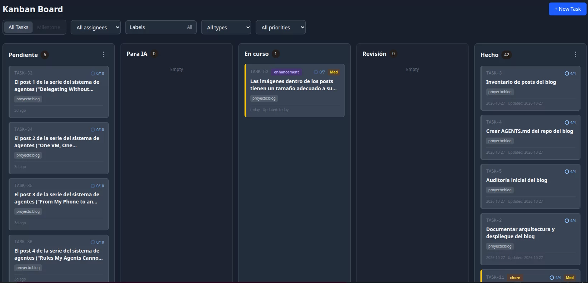

Until not long ago, my way of working with AI agents was always the same. I opened a terminal, started a session, explained the task, and then stayed there. The agent asked for permission to run a command, I said yes. It asked which file it should touch, I answered. It finished one thing and waited for the next one.

The agent was doing the work, but I was still sitting in front of it.

That is not really delegating. It is pair programming where I do the boring part.

What I wanted was simpler to say than to build: write a task, move it to a column called *Ready for AI*, even from my phone, and get it back later in *Review*, finished or with a clear question. Without touching anything in the middle.

So I built a small system for that. This is the first post of a series about it: why I did it and how the pieces fit.

## What I Wanted From It

Before installing anything I wrote down five goals:

* **Delegate without watching.** I move a task to *Ready for AI* and it comes back in *Review* without me intervening on the way.
* **My time is for deciding and reviewing.** Creating a task should take me less than 5 minutes, and reviewing one less than 15.
* **Safe by design.** The agents have no more access than they need, nothing reaches `main` or production without my approval, and the system does not change itself.
* **Rebuildable.** If the machine dies, I can bring it back from my own guides and the notebook repository.
* **No extra cost.** It works with the subscriptions I already pay for. No API bills.

The 5 and 15 minutes are targets, not a promise. But they are a good reminder: if writing a task takes half an hour, the problem is in how I ask, not in the agent.

## The Pieces, in One Line Each

* **An isolated VM** on my [Proxmox](https://www.proxmox.com/) server at home. The agents run there with a user without sudo, and I reach it only from home or through [WireGuard](https://www.wireguard.com/).
* **[Codeman](https://getcodeman.com/)**, which runs the agent sessions and lets me open them from any browser, also from the phone. I use three agents with it: [Claude Code](https://claude.com/product/claude-code), [Codex](https://openai.com/codex/) and [Antigravity](https://antigravity.google/).
* **The notebook**, one git repository of Markdown files. I read and write my notes in it with [SilverBullet](https://silverbullet.md/), and the tasks live in the same repository, managed with [Backlog.md](https://github.com/MrLesk/Backlog.md) and its kanban.
* **The rules**, one `AGENTS.md` file that all the agents read: which tasks they can take, where they can write, how they must finish and what they can never touch.
* **The dispatcher**, a [systemd](https://systemd.io/) timer that every 10 minutes takes the next task from *Ready for AI* and opens an agent session for it.

The notebook is in Spanish, so the screenshots in this series are in Spanish too. The five columns of the kanban are *Pendiente* (Backlog), *Para IA* (Ready for AI), *En curso* (In progress), *Revisión* (Review) and *Hecho* (Done):

## Who Does What

I create the tasks, I move them to *Ready for AI*, I review them and I move them to *Done*. If a task touches code, I open the pull request and I merge it. No agent does any of these things.

The agent only works on what is in *Ready for AI*, and it always returns the task to *Review*. Finished, blocked or with a question, but never left in *In progress*. When something is not clear, the rule is not to guess: write the question in the task, add the label *question* (`pregunta`) and give it back to me. The dispatcher only gives the agent one fixed sentence: work on this task following `AGENTS.md`. Everything else is in the rules and the task.

This comes from [something I wrote some months ago, in Spanish, about AI](/es/esto-marcara-un-aintes-y-un-despues/): no matter how good the tool is, **you are still the last one responsible**, and a person should be the one who presses the button and decides. Here that is not only an idea. The agents push to their own branch, `main` is protected, and the button to merge is mine.

It also follows what I learned [studying physics with ChatGPT](/passing-math-heavy-physics-subject-with-chatgpt/): the clearer and more structured the instructions, the better the result, and it helps a lot to ask it to show where things come from. So every task has a description, limits and acceptance criteria, and the agent has to prove each criterion in its result.

## Does It Work?

The first project in the system was this blog, and most of the changes you do not see were tasks done by agents. Some examples:

* The sitemap listed 129 URLs and 100 of them returned a 404. An agent fixed it, and another one checked that every Spanish post is in the Spanish sitemap.
* Broken links now show a proper 404 page instead of the generic one from the hosting.
* Most pages had five `h1` headings because of the contact block in the footer. Now there is one, and the language switcher is accessible.
* [Hugo](https://gohugo.io/) went from 0.122.0 to a current version, and the build uses the official image.
* Internal links are relative now, so I can browse the preview of a pull request without being sent to production.

Even this series started as a task: an agent proposed the index of posts from my notes, and I corrected it.

It is not perfect. Once an agent stopped and asked me because two of my own rules said opposite things, and it was right. The dispatcher only notices a stuck task if its session is closed, so an agent waiting forever with the session open blocks everything until I look. And for a while my documentation said that the dispatcher made a snapshot of the VM before each task, which it never did. Those stories go at the end of the series.

## What This Series Is Not

This is not a product, and it is not a step by step guide to copy. I want to explain what each piece does and why I decided it, so you can take the ideas that fit your setup.

What comes next:

* One VM, one unprivileged user: where my AI agents live.
* The notebook, the kanban and the life of a task, from my phone to an agent.
* The rules my agents cannot edit.
* The dispatcher that hands tasks to my agents every ten minutes.
* What went wrong, and what I learned.

## Conclusion

I did not build this because agents are perfect. I built it because they are good enough to work alone for a while, and I did not want to spend that while watching them.

The agents work. I decide. And honestly, that split is the part I like the most.
