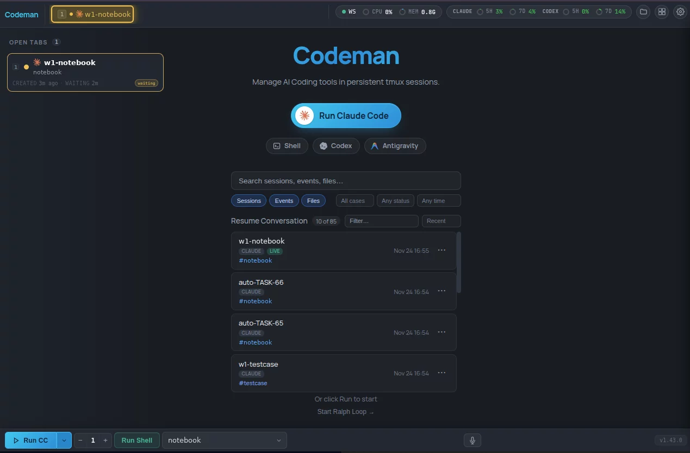
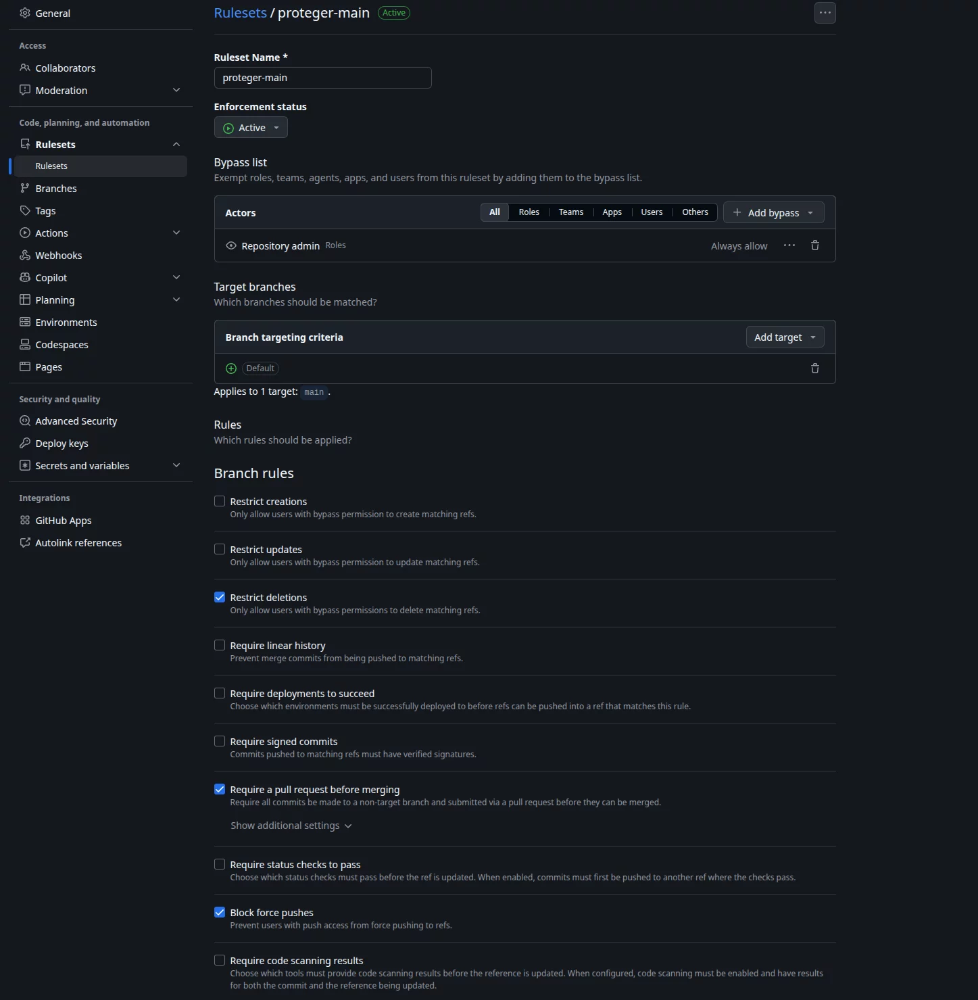

When I installed [Codeman](https://getcodeman.com/) and opened its settings, the first thing I saw was that it starts Claude Code with `--dangerously-skip-permissions` by default. No confirmations. The agent runs whatever command it decides to run.

The name is honest, at least.

I wanted exactly that: agents that work alone while I do something else. But I only accept it if the place where they run is built so that "whatever command" cannot hurt much. This post is about that place. It is the second one of the series about my AI agent system. The [first one](/delegating-to-ai-agents-without-watching/) explains why I built it.

![Diagram of where my AI agents live: from the left, my phone and laptop through WireGuard and my home PC reach the OpenWrt router, and from there the Proxmox firewall, which only lets in ports 443 and 22; the internet has no way in. Inside the Debian VM, Caddy serves HTTPS in front of three services on 127.0.0.1: the agents in Codeman, SilverBullet notes and the Backlog.md kanban with a login added by Caddy. Below them, two users: admin-user with sudo and agent-user without sudo, who owns the services and /srv/repos. On the right, the VM can reach the internet and GitHub, where each repository has its own deploy key and main is protected, but it cannot open connections to other guests, Proxmox or the routers. At the bottom, the host: a Lenovo ThinkCentre M70q Tiny with an i7-12700T, 64 GB of RAM and Proxmox VE 9.2](agent-vm-isolation.webp)

## The Homelab

Everything runs on a mini PC at home: a Lenovo ThinkCentre M70q Tiny with an Intel Core i7-12700T (12 cores, 20 threads) and 64 GB of RAM, running [Proxmox](https://www.proxmox.com/) VE 9.2. It has two disks: a SATA SSD for Proxmox itself and an NVMe with ZFS for the VM disks.

The VM is [Debian](https://www.debian.org/) 13, created from the *genericcloud* image with cloud-init. It has 6 vCPU, 16 GB of fixed RAM (no ballooning) and two disks, both on the NVMe: 40 GB for the system and 100 GB for `/srv/repos`, where all the repositories live.


Proxmox shows the system disk as 41G because I grew the cloud image by 38 GB, and the image already had a few. Close enough to 40.

Why these numbers? The agents spend most of their time waiting for the model, so 6 vCPU are more than enough, and the CPU only works when they build or run tests. And the separate disk for repositories means I can rebuild the system without touching the work.

## The Firewall Does the Real Isolation

The VM is in the same network as everything else at home. That means the router cannot filter traffic between them, but the Proxmox firewall can, because it sits on the VM's network card.

The rules of the VM, with documentation addresses (`192.0.2.0/24` is the home network, `198.51.100.0/24` the WireGuard clients, and both form the IPSet `mgmt`):

| # | Direction | Action | Destination | Protocol / port | What for |
| --- | --- | --- | --- | --- | --- |
| 1 | in | ACCEPT | | tcp 443 | HTTPS from `+mgmt` |
| 2 | in | ACCEPT | | tcp 22 | SSH from `+mgmt` |
| 3 | in | ACCEPT | | icmp | ping from `+mgmt` |
| 4 | out | ACCEPT | `192.0.2.1` | udp 53 | DNS of the router |
| 5 | out | ACCEPT | `192.0.2.1` | tcp 53 | DNS of the router |
| 6–10 | out | DROP | `10.0.0.0/8`, `172.16.0.0/12`, `192.168.0.0/16`, `100.64.0.0/10`, `169.254.0.0/16` | any | no private networks |

The input policy is `DROP` and the output policy `ACCEPT`. So the internet works, but the VM cannot start a connection to Proxmox, the routers or the other guests on the same host. Replies to my own SSH session still pass, because conntrack accepts them.

**The order matters.** The first rule that matches wins, so the DNS rules must be above the `DROP`s.

To check it, from inside the VM:

```sh
curl -sk --max-time 5 https://192.0.2.10:8006 && echo "BAD: I reach Proxmox" || echo "ok: Proxmox blocked"
curl -s --max-time 5 https://example.org >/dev/null && echo "ok: internet works"
```

The first one has to fail and the second one has to answer.

## Only From Home or Through WireGuard

The VM's name does not exist in public DNS. Only the DNS of my [OpenWrt](https://openwrt.org/) router knows it. From outside, my phone and my laptop connect with [WireGuard](https://www.wireguard.com/) to the router, and each one has its own peer. The laptop's looks like this:

```ini
[Interface]
PrivateKey = <private key>
Address    = 198.51.100.3/32
DNS        = 198.51.100.1

[Peer]
PublicKey           = <public key>
PresharedKey        = <preshared key>
Endpoint            = vpn.example.com:51820
AllowedIPs          = 192.0.2.13/32, 198.51.100.1/32
PersistentKeepalive = 25
```

`AllowedIPs` only sends the VM and the DNS through the tunnel. Proxmox stays out of reach even with the VPN on.

## Caddy in Front, Everything Else on Localhost

I wanted real HTTPS without exposing anything. [Caddy](https://caddyserver.com/) gets a [Let's Encrypt](https://letsencrypt.org/) certificate with the DNS-01 challenge: it creates a temporary TXT record with a [Cloudflare](https://www.cloudflare.com/) API token limited to that zone, so no public record points to the VM.

The Caddy package does not include the Cloudflare plugin, so I built it with [xcaddy](https://github.com/caddyserver/xcaddy) and installed it with `dpkg-divert`, so `apt upgrade` does not replace it.

```text
agents.home.arpa {
	tls {
		dns cloudflare {env.CF_API_TOKEN}
		resolvers 1.1.1.1 1.0.0.1
	}
	reverse_proxy 127.0.0.1:3000 {
		flush_interval -1
	}
}

tasks.home.arpa {
	tls {
		dns cloudflare {env.CF_API_TOKEN}
	}
	basic_auth {
		<user> <hash>
	}
	reverse_proxy 127.0.0.1:6420
}
```

`flush_interval -1` is there because Codeman sends its dashboard by SSE, and with buffering the page freezes. The second site is the Backlog.md kanban, which has no login of its own, so Caddy adds one. The notes site, SilverBullet, is like the first one and has its own login. More about both in the next post.

Every service listens on `127.0.0.1`. This is what `ss -ltn` shows, trimmed:

```text
Local Address:Port
0.0.0.0:443         # Caddy
127.0.0.1:3000      # Codeman
127.0.0.1:3001      # SilverBullet
127.0.0.1:6420      # Backlog.md kanban
0.0.0.0:22          # SSH
```

## Two Users, and Only One Has Sudo

`admin-user` has sudo and enters only with an SSH key. I use it for the few things that need root: Caddy, `/etc/fstab` and little more.

`agent-user` has no sudo. It runs Codeman, the agents and the notebook services as systemd user services, and it owns `/srv/repos`:

```sh
sudo adduser --disabled-password --gecos "" agent-user
sudo chown agent-user:agent-user /srv/repos
sudo loginctl enable-linger agent-user   # its services start without a login session
```

A warning if you copy this: log in as that user with `ssh`, not with `sudo su`. Otherwise `systemctl --user` fails with `Failed to connect to bus`.

## My Subscriptions, Not the API

The agents are [Claude Code](https://claude.com/product/claude-code) with my Pro/Max plan, [Codex](https://openai.com/codex/) with ChatGPT and the [Antigravity](https://antigravity.google/) CLI with Google AI Pro. Each one logged in once inside the VM, and their credential folders are `chmod 700`. No API keys and no extra bills, which was one of my goals.

Antigravity is there because [Gemini CLI stopped serving consumer accounts](https://developers.googleblog.com/an-important-update-transitioning-gemini-cli-to-antigravity-cli/) in June 2026, and Antigravity CLI is its replacement. [Node.js](https://nodejs.org/) 24 comes from [NodeSource](https://github.com/nodesource/distributions), because the version in Debian is too old for Codeman.

## Codeman

Codeman runs agent sessions in the browser, also from my phone. I installed it as `agent-user` with `--local`, so it only listens on `127.0.0.1`, and as a user service. The installer never writes the password, so it goes in its own file:

```ini
# ~/.config/systemd/user/codeman-web.service.d/override.conf
[Service]
EnvironmentFile=%h/.config/codeman.env
```

```sh
# ~/.config/codeman.env (chmod 600)
CODEMAN_USERNAME=<user>
CODEMAN_PASSWORD=<secret>
CODEMAN_ALLOWED_HOSTS=agents.home.arpa
```

`CODEMAN_ALLOWED_HOSTS` makes it refuse any other name, including the IP.



Codeman works with *cases*, and it creates each one as a new folder. It does not accept an existing folder, and a symlink disappears from the list after the first time. So my notebook is a case with a bind mount: Codeman created the folder, and the notebook repository is mounted on top. After each Codeman update I also regenerate its hooks, because the existing cases keep the old ones. How I found out about the symlink is a story for the last post.

## GitHub: One Key per Repository

The VM has a deploy key with write access for each repository the agents use, and an SSH alias for each one. Never a key in my account, because that would open all my repositories.

```text
Host github-blog
    HostName github.com
    User git
    IdentityFile ~/.ssh/id_ed25519
    IdentitiesOnly yes
```

`main` in the [blog repository](https://github.com/pablogarcor/js-pablogarcor-web) has a ruleset: no deletion, no force push and a pull request before merging.



The only one in the bypass list is the repository admin, which is me. The deploy key is not there.

The agents work in a worktree and a branch `agente/<task>`, and they never push to `main`. They do not use `gh` either: they leave a link with the pull request already filled in, and I open it.

## Why I Accept No Confirmations

With all of this, `--dangerously-skip-permissions` looks different. The user has no sudo, the firewall keeps the VM away from the rest of my home, and GitHub blocks force pushes and direct changes to `main`. If an agent does something stupid, the damage stays inside the VM and inside its own branch.

Tools follow the same idea. Hugo and the rest go in `/srv/repos/.tools/<tool>-<version>/`, installed by version, and there is no Docker.

## What This Does Not Cover

It is not perfect, and I prefer to say where.

* **One user for everything.** All the agents and SilverBullet run as `agent-user`. My rules tell the agents not to read secrets, but technically they can read any file of that user, including the credentials of the notes app.
* **No containers.** Codeman can run sessions in containers, but I did not set that up. Every agent sees the whole home of `agent-user`.
* **The CLIs' own config is outside my barriers.** In a later post I protect the rules files of the notebook, but `~/.claude`, `~/.codex` and `~/.gemini` stay writable.
* **No backups.** I take VM snapshots by hand before leaving the agents alone, and the dispatcher does not take any. **There is no backup job**, even if my own guide says it is not optional, because the NVMe is a single disk without redundancy. Today, what saves the work is `git push`.

## Conclusion

None of these pieces is special alone. A user without sudo, a firewall, localhost, a VPN and a protected branch. Together they are what lets me close the laptop while an agent works.

And the backups are on my list. Really.
