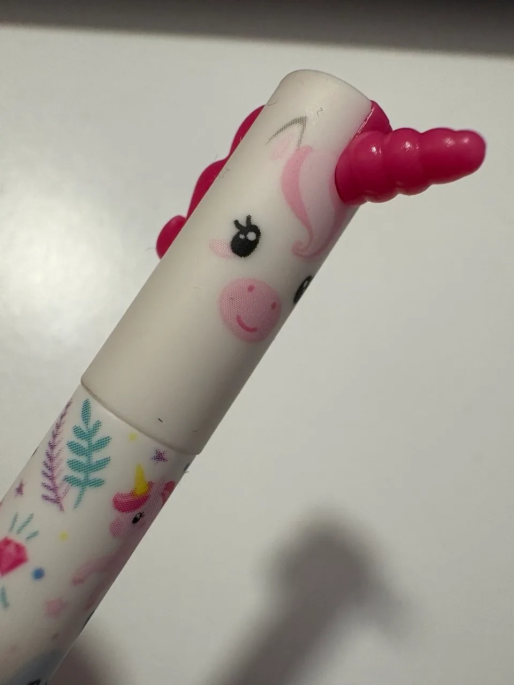

Perfección. Hay que se el mejor. O ganar o nada. Todos aspiramos a ser inigualables en lo nuestro pero este anhelo muchas veces puede convertirse en una maldición, cuando la búsqueda de la perfección se convierte en una excusa perpetua para no hacer algo. "Es que aun no está pulido", se repite en la cabeza una y otra vez, simplemente para servir de excusa para darle una patada hacia delante y no hacerlo hasta que lo esté. Da igual lo que sea, un proyecto, comprar algo, un cambio de vida, siempre hay algo que perfeccionar o esperar al momento ideal para hacerlo, este no es, el siguiente tampoco... un enorme día de la marmota donde lo único claro es que nunca llegará esa perfección inexistente.

La existencia de esa perfección es irrelevante, el momento adecuado, lo ideal, todo eso es relativo y la única certeza es que hacer las cosas es lo que de verdad marcará la diferencia. Si dudas, hazlo, si no estás seguro, hazlo, siempre se puede mejorar pero si nunca empiezas todo se queda en una idea en tu mente que jamás alcanzará el punto de perfección que deseas. La inacción que genera esta búsqueda de la perfección no es mas que miedo, miedo al fracaso, a equivocarte, miedo a caer, una excusa autoinventada con la perfección como disfraz.

### Solo hazlo

Como decía el eslogan de Nike, "just do it". No se si existe o no la perfección, pero si se que existe el miedo a caer. Muchas veces no estamos preparados para afrontarlo pero siempre es mejor haberlo intentado y fracasar que no haberlo intentado nunca. Asi que si tu excusa es que aun no está perfecto, deja de engañarte y hazlo, siempre habra tiempo de mejorar.
