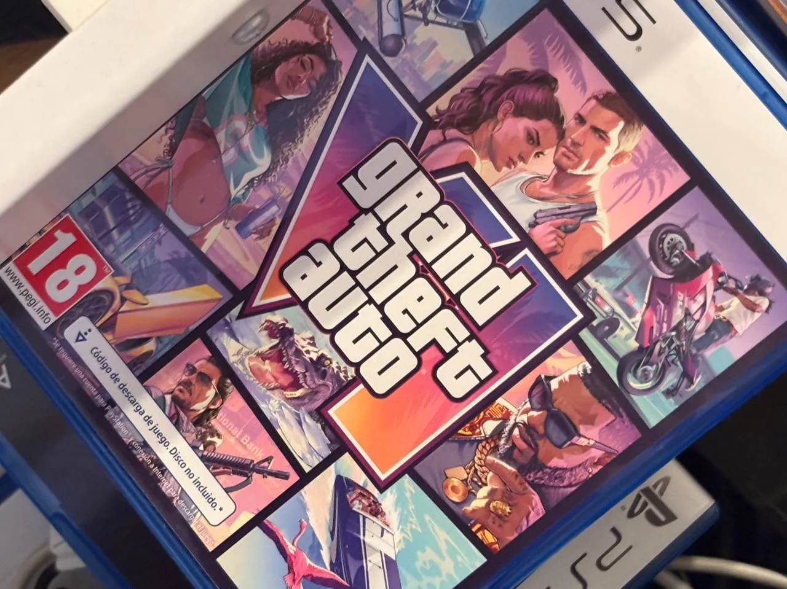

Pocas veces un suceso así sacude tan fuerte a la sociedad. En mi círculo cercano esto ha afectado más que el apagón: gente que se lleva horas sin dar señales de vida, desaparecidos mientras vician todo lo que pueden a este esperado juego. También están los que son poco o nada jugones, pero, absorbidos por la moda del momento, ahora son los fans más acérrimos.

### La moda manda

No he querido leer demasiado en redes, porque soy de los que intentan jugar todo lo que pueden con el tiempo que les queda después de currar y hacer las tareas que un adulto debe afrontar cada día. Aun así, es imposible no encontrarse de vez en cuando con algún tweet o comentario, unas veces positivos, otras negativos. La cosa es que todo el mundo tiene que tener una opinión al respecto.

### Las opiniones son como los culos

Cada uno tiene el suyo. Al final me cansan los mal llamados influencers dando opiniones de mierda, sean a favor o en contra. Un videojuego es como una película: mírala y decide qué te parece. Por favor, juega tú mismo, no te dediques a ver el stream de otro para poder regurgitar su opinión y vomitarla en reuniones cuando salga el tema. Muchas veces está bien no tener opinión sobre algo que no te gusta o que no te importa. Lo importante es tener criterio propio y no dejarse arrastrar por la corriente. Hace dos semanas era la bola negra; ahora, GTA 6… Qué cansancio. Es tu tiempo libre: aprovéchalo en lo que te guste, no en lo que te digan que te tiene que gustar.

### Mi reseña

Mi opinión sobre el juego es… bah, ni a mí me importa. Juégalo o no lo juegues. Pero ya sabes: hasta dentro de unas semanas, todo estará cerrado por GTA 6.
